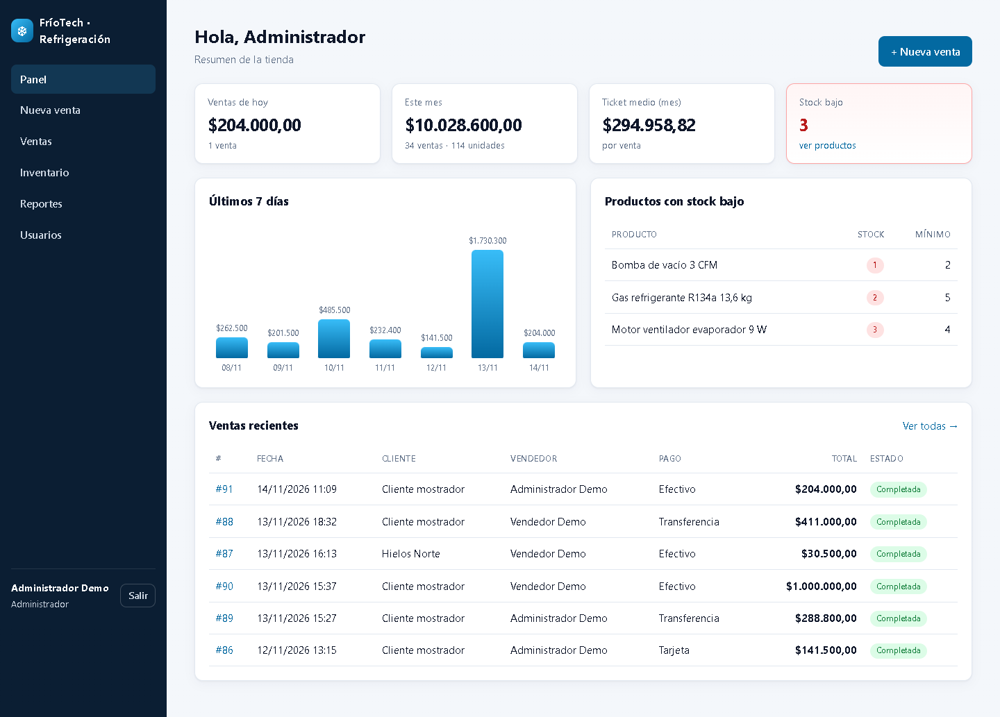
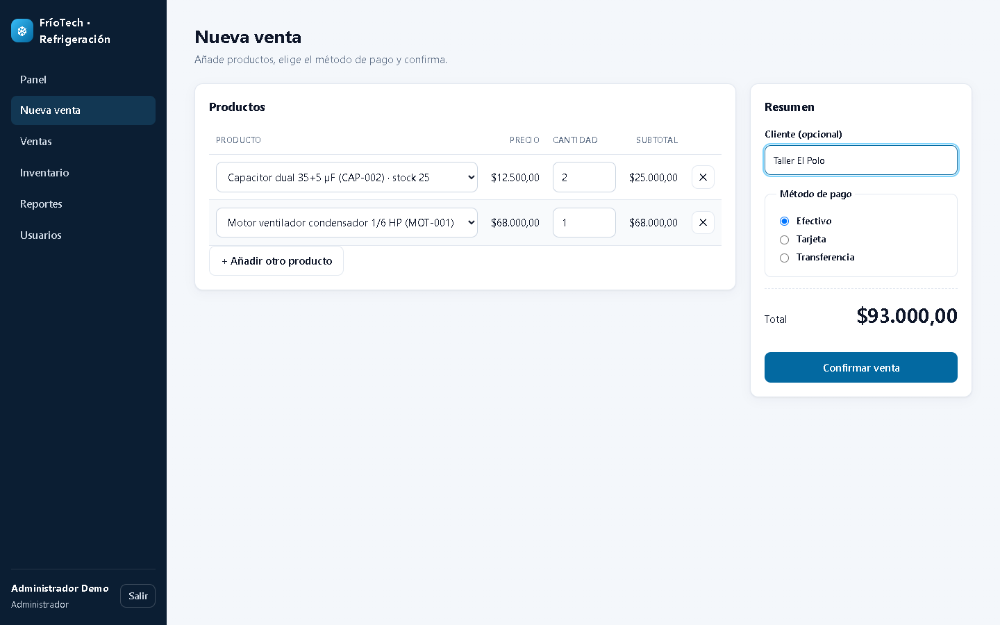
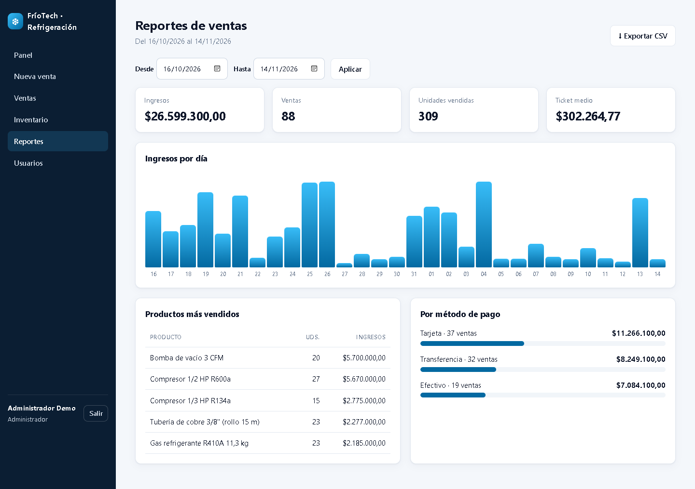
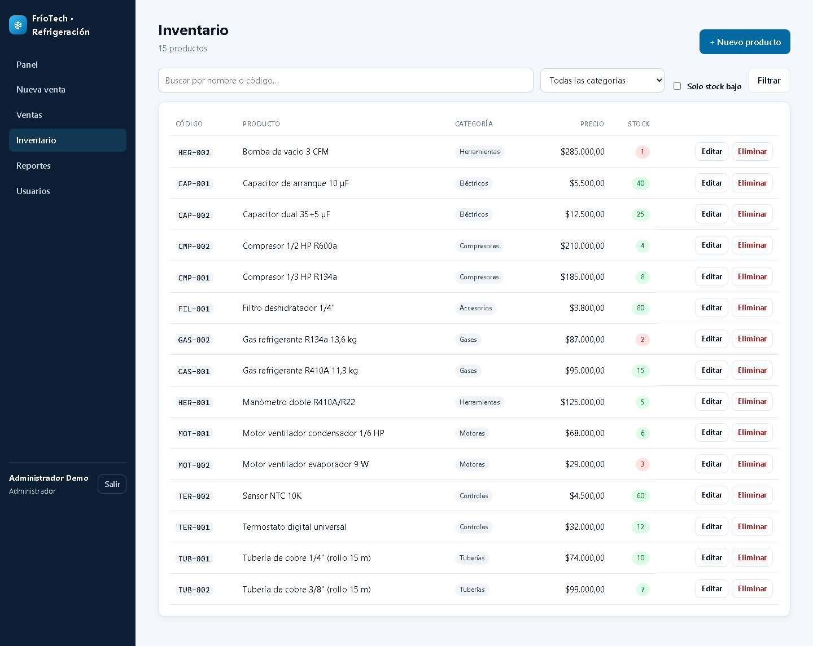
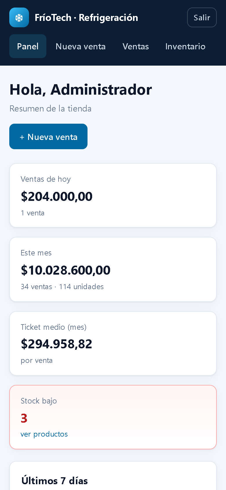

# ❄ Sistema de Ventas e Inventario

[](https://github.com/frankbuitrago3-code/sistema-ventas/actions/workflows/ci.yml)


Aplicación web para gestionar las **ventas y el inventario** de una tienda de repuestos de refrigeración. Permite registrar ventas con varios productos, controlar el stock en tiempo real, ver indicadores del negocio y exportar reportes, con usuarios y permisos por rol.



## Funcionalidades

| Módulo | Qué hace |
|---|---|
| **Panel** | Ventas del día y del mes, ticket medio, gráfico de los últimos 7 días, alertas de stock bajo y ventas recientes. |
| **Nueva venta** | Carrito con varios productos, cálculo del total en vivo, método de pago (efectivo, tarjeta o transferencia) y cliente opcional. El stock se descuenta automáticamente. |
| **Inventario** | Alta, edición y baja de productos con código SKU, categoría, precio y stock mínimo. Búsqueda, filtros y paginación. |
| **Ventas** | Historial con filtros, detalle imprimible de cada venta y **anulación** con devolución del stock al inventario. |
| **Reportes** | Ingresos por día en un rango de fechas, productos más vendidos, ventas por método de pago y **exportación a CSV** (compatible con Excel). |
| **Usuarios** | Roles de *administrador* y *vendedor*, alta de usuarios, activación/desactivación y cambio de contraseña. |

<table>
  <tr>
    <td></td>
    <td></td>
  </tr>
  <tr>
    <td></td>
    <td align="center"></td>
  </tr>
</table>

## Decisiones técnicas

- **Ventas atómicas.** Cada venta se guarda en una única transacción (`BEGIN IMMEDIATE`): se valida el stock de todas las líneas, se crea la venta y se descuenta el inventario. Si algo falla, no se guarda nada y el stock no queda a medias.
- **Importes en centavos.** El dinero se almacena como enteros para evitar los errores de redondeo de los decimales en coma flotante.
- **Historial fiel.** Cada línea de venta guarda el nombre y el precio *del momento de la venta*. Si el precio de un producto cambia después, las ventas antiguas no se alteran. Los productos se desactivan en lugar de borrarse.
- **Seguridad:**
  - Contraseñas con hash (Werkzeug/PBKDF2).
  - Protección **CSRF** en todos los formularios.
  - Cookies de sesión `HttpOnly` y `SameSite`.
  - Control de acceso por rol: un vendedor solo ve sus propias ventas y no puede anular ventas ni modificar el inventario.
  - Protección contra redirecciones abiertas en el login.
  - Consultas SQL siempre parametrizadas.
- **Sin dependencias innecesarias.** Flask y la librería estándar de Python. Los gráficos están hechos con HTML y CSS, sin librerías de JavaScript.
- **Responsive.** Funciona en ordenador, tablet y móvil.

## Tecnologías

**Backend:** Python 3 · Flask 3 · SQLite  
**Frontend:** HTML5 · CSS3 (Grid/Flexbox, sin frameworks) · JavaScript  
**Calidad:** pytest (35 pruebas) · GitHub Actions (CI en Python 3.11, 3.12 y 3.13)

## Estructura

```
sistema-ventas/
├── app/
│   ├── __init__.py      # Fábrica de la aplicación (create_app)
│   ├── auth.py          # Login, logout y control de acceso por rol
│   ├── productos.py     # Inventario
│   ├── ventas.py        # Registro, historial y anulación de ventas
│   ├── reportes.py      # Panel, reportes y exportación CSV
│   ├── usuarios.py      # Gestión de usuarios
│   ├── seguridad.py     # Protección CSRF
│   ├── db.py            # Conexión SQLite y comandos de consola
│   ├── schema.sql       # Esquema de la base de datos
│   ├── templates/       # Vistas Jinja2
│   └── static/          # CSS y JavaScript
├── tests/               # Pruebas automáticas (pytest)
├── docs/                # Capturas de pantalla
└── wsgi.py              # Punto de entrada para producción
```

## Cómo ejecutarlo

Requisitos: **Python 3.11 o superior**.

```bash
git clone https://github.com/frankbuitrago3-code/sistema-ventas.git
cd sistema-ventas

python -m venv .venv
# Windows: .venv\Scripts\activate    ·    Linux/macOS: source .venv/bin/activate
pip install -r requirements-dev.txt

# Opción A: cargar datos de demostración (usuarios, 15 productos y 30 días de ventas)
flask --app app datos-demo

# Opción B: empezar desde cero con tu propio administrador
flask --app app init-db
flask --app app crear-admin

flask --app app run
```

Abre <http://127.0.0.1:5000>. Con los datos de demostración puedes entrar como:

| Usuario | Contraseña | Rol |
|---|---|---|
| `admin` | `admin123` | Administrador |
| `vendedor` | `vendedor123` | Vendedor |

> Los usuarios de demostración son solo para probar en local. En producción, crea tu propio administrador y define la variable `SECRET_KEY` (ver `.env.example`).

### Instalador para Windows (para entregar a un negocio)

Crea un único `SistemaDeVentas.exe` que no necesita Python instalado:

```bash
pip install -r requirements-build.txt
pyinstaller --noconfirm --clean --distpath empaquetado/dist --workpath empaquetado/build empaquetado/SistemaDeVentas.spec
```

- La primera vez que se abre, muestra una **pantalla de configuración inicial**: el negocio escribe su nombre y crea su usuario administrador. No hay usuarios ni datos de ejemplo.
- Los datos se guardan en `%LOCALAPPDATA%\SistemaVentas`, separados del programa: se puede reemplazar el `.exe` por una versión nueva sin perder nada.
- La clave secreta de la sesión se genera automáticamente en el primer arranque.
- El sistema solo escucha en `127.0.0.1` (no es accesible desde otros equipos de la red).
- Entrega el `.exe` junto con `empaquetado/INSTRUCCIONES.txt`.

### Pruebas

```bash
pytest -q
```

Las pruebas cubren:
- la autenticación y los permisos por rol;
- el rechazo de formularios sin token CSRF;
- el cálculo de totales y el descuento de stock;
- que no se pueda vender más de lo que hay en stock;
- el *rollback* cuando una venta falla;
- la anulación de ventas;
- los reportes y la exportación a CSV.

### Producción

```bash
export SECRET_KEY="una-clave-larga-y-aleatoria"
gunicorn wsgi:app
```

## Próximas mejoras

- Gestión de clientes y proveedores, con compras que sumen stock.
- Reportes en PDF.
- Historial de movimientos de inventario.
- Imagen Docker.

## Licencia

[MIT](LICENSE) © smartbyte
